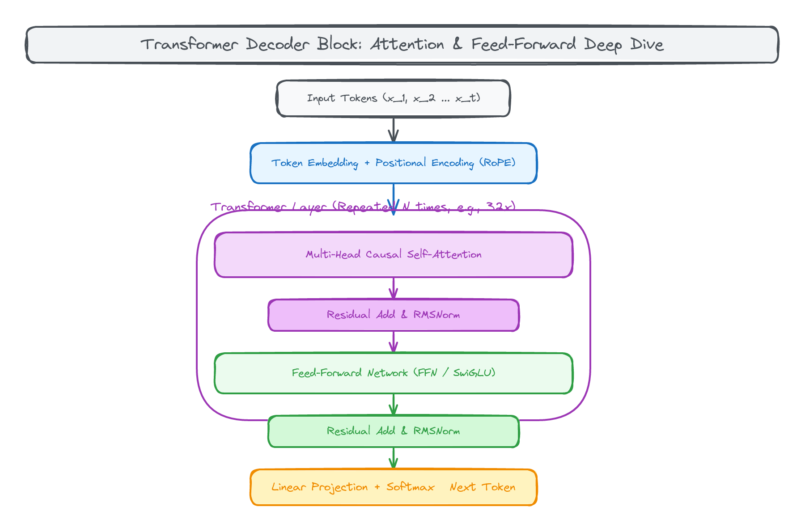
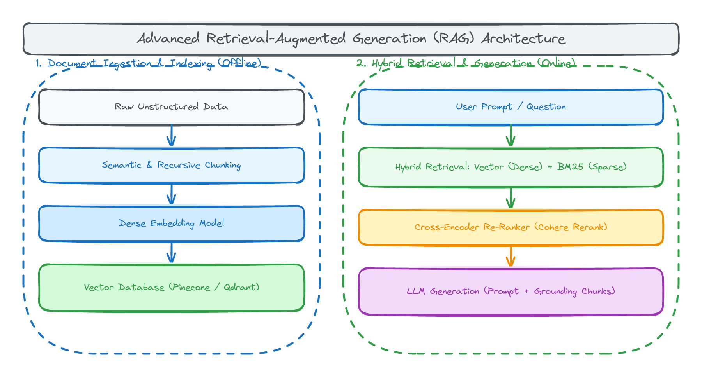

# Generative AI & Large Language Models — From Basics to Expert

## Core Foundations
- **Generative vs Discriminative AI**:
  - *Discriminative AI*: Models conditional probability $P(Y \mid X)$ to classify or predict labels (e.g., spam detection, sentiment analysis, image classification).
  - *Generative AI*: Models joint probability $P(X, Y)$ or data distribution $P(X)$ to generate novel text, images, audio, or code matching learned distributions.
- **Foundation Models (FMs)**:
  - Massive neural networks trained on broad data at scale via self-supervised learning, adaptable to a wide array of downstream tasks without task-specific training from scratch.
  - History of Foundation Models:
    
- **Modalities**:
  - **LLMs (Text & Code)**: GPT-4, LLaMA 3, Claude 3.5, Gemini, Mistral.
  - **Diffusion Models (Images & Video)**: Stable Diffusion, Midjourney, DALL-E 3, Sora (reverses forward Gaussian noise step-by-step).
  - **Audio & Speech**: Whisper (ASR), ElevenLabs, AudioLM.

---

## Transformer Architecture Internals



- Introduced in *"Attention Is All You Need"* (Vaswani et al., 2017). Replaced recurrent networks (RNNs/LSTMs) by enabling massive parallel processing across sequence tokens.
- **Self-Attention Mechanism**:
  - Computes contextual relationships between all token pairs in a sequence regardless of distance.
  - Linear projections of token embeddings into Query ($Q$), Key ($K$), and Value ($V$) matrices ($d_k$ = projection dimension):
    $$\text{Attention}(Q, K, V) = \text{softmax}\left(\frac{QK^T}{\sqrt{d_k}}\right)V$$
  - $\frac{1}{\sqrt{d_k}}$ scaling factor prevents dot products from growing excessively large, which would drive softmax into vanishing gradient regions.
- **Multi-Head Attention (MHA)**: Runs attention $h$ times in parallel with distinct learned parameter matrices, enabling the model to jointly attend to information from different representation subspaces.
- **Positional Embeddings**: Since self-attention is permutation-invariant, positional information must be injected:
  - *Absolute / Sinusoidal Embeddings*: Fixed sinusoidal wave functions added to input embeddings.
  - *RoPE (Rotary Position Embedding)*: Encodes relative positions by rotating query and key representations in complex vector space (standard in LLaMA, Mistral, modern architectures).
- **Architectural Variations**:
  - **Encoder-Only (BERT)**: Bidirectional context; ideal for sentence embeddings, classification, and extraction.
  - **Decoder-Only (GPT, LLaMA)**: Causal (masked) attention; tokens can only attend to previous tokens. Standard for generative text and code completion.
  - **Encoder-Decoder (T5, BART)**: Separate encoder processes input, autoregressive decoder generates output; popular for translation and summarization.

---

## Model Training & Adaptation Lifecycle

```
[ Massive Web Corpus ] ➔ Pre-Training (Next Token Prediction) ➔ Base Model
     ➔ Supervised Fine-Tuning (SFT / Instruction Tuning) ➔ Instruct Model
          ➔ Alignment (RLHF / DPO) ➔ Safe, Aligned Assistant
```

### 1. Pre-Training
- Self-supervised learning on multi-trillion token corpora (Common Crawl, GitHub, books, papers).
- Objective: Causal Language Modeling (predicting the next token $x_t$ given $x_1, \dots, x_{t-1}$).
- Massive GPU clusters (H100/A100) running Distributed Data Parallel (DDP), Megatron-LM tensor parallelism, and ZeRO (Zero Redundancy Optimizer).

### 2. Supervised Fine-Tuning (SFT / Instruction Tuning)
- Fine-tunes base models on curated prompt-response pairs to teach them conversational and instruction-following behaviors.

### 3. Alignment: RLHF & DPO
- **RLHF (Reinforcement Learning from Human Feedback)**:
  - Trains a Reward Model based on human preference rankings.
  - Optimizes the policy LLM via Proximal Policy Optimization (PPO) with a KL-divergence penalty to prevent policy drift.
- **DPO (Direct Preference Optimization)**:
  - Mathematically bypasses training a separate reward model, optimizing policy weights directly on preference pairs $(y_w \succ y_l)$ using binary cross-entropy loss.

### 4. Parameter-Efficient Fine-Tuning (PEFT)
- Avoids updating all billions of parameters during fine-tuning:
  - **LoRA (Low-Rank Adaptation)**: Freezes original weights $W_0 \in \mathbb{R}^{d \times k}$ and injects trainable rank decomposition matrices $A \in \mathbb{R}^{d \times r}$ and $B \in \mathbb{R}^{r \times k}$ with rank $r \ll \min(d, k)$. Reduces trainable parameters by $>99\%$.
  - **QLoRA**: Quantizes base model weights to 4-bit NormalFloat (NF4) precision, enabling 70B parameter models to be fine-tuned on consumer GPUs.

---

## Retrieval-Augmented Generation (RAG)



- Overcomes LLM limitations: hallucinations, lack of private domain data, and knowledge cutoff dates.
- **Standard RAG Pipeline**:
  1. **Ingestion & Chunking**: Documents parsed and split into semantic chunks (e.g., 512 tokens with 50-token overlap).
  2. **Embedding**: Text chunks transformed into dense vectors via embedding models (e.g., `text-embedding-3`, BGE).
  3. **Vector Database**: Stored with metadata in vector databases (**Pinecone**, **Qdrant**, **Milvus**, **pgvector**).
  4. **Retrieval**: User query embedded and matched via cosine similarity or Approximate Nearest Neighbors (ANN using HNSW graphs).
  5. **Augmentation & Generation**: Top-$K$ relevant chunks injected into system prompt as grounding context for the LLM.
- **Advanced RAG Patterns**:
  - **Hybrid Search**: Combines dense semantic vector search with sparse keyword search (BM25) via Reciprocal Rank Fusion (RRF).
  - **Re-Ranking**: High-precision Cross-Encoder (e.g., Cohere Re-rank) scores retrieved chunks to eliminate irrelevant context before prompt assembly.
  - **HyDE (Hypothetical Document Embeddings)**: LLM generates a hypothetical answer first, which is embedded to retrieve similar authentic documents.

---

## AI Agents, Tool Use & Orchestration
- **Function Calling & Tool Execution**:
  - Model emits structured JSON indicating function name and arguments (e.g., `{"name": "get_weather", "arguments": {"city": "Seattle"}}`).
  - Runtime executes the API call and feeds result back to the LLM to formulate final response.
- **Agent Reasoning Loops**:
  - **ReAct (Reason + Act)**: Interleaves Thought, Action, and Observation steps in an iterative loop until the goal is satisfied.
  - **Plan-and-Solve**: Breaks high-level user goals into directed acyclic task graphs before execution.
- **Agent Frameworks**: **LangChain**, **LlamaIndex**, **CrewAI**, **AutoGPT**, and **MCP (Model Context Protocol)**.

---

## Curated References & Tutorials
- [LangChain Python Tutorials](https://python.langchain.com/docs/tutorials/)
- [LlamaIndex LlamaParse Guide](https://docs.cloud.llamaindex.ai/llamaparse/getting_started/python)
- [Hugging Face RAG with Unstructured Data](https://huggingface.co/learn/cookbook/en/rag_with_unstructured_data)
- [Meta Llama Prompting Guide](https://www.llama.com/docs/how-to-guides/prompting/)
- [Meta Llama Cookbook Prompt Engineering](https://github.com/meta-llama/llama-cookbook/blob/main/getting-started/Prompt_Engineering_with_Llama.ipynb)
- [PromptPerfect Optimization](https://promptperfect.jina.ai/)
