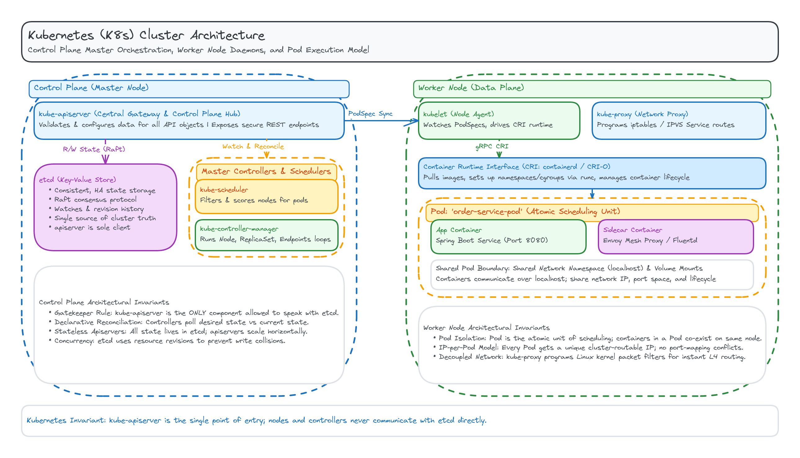

# Kubernetes — From Basics to Expert

## Kubernetes Architecture



### Control Plane Components (Master Node)
- **`kube-apiserver`**: The front end of the control plane; exposes the Kubernetes API (`kubectl` and all components communicate exclusively through it). Stateless, horizontally scalable.
- **`etcd`**: Consistent, highly-available distributed key-value store (using Raft consensus) holding the entire cluster state and configuration. Never write to it directly.
- **`kube-scheduler`**: Watches for newly created Pods with no assigned node and selects the optimal worker node based on resource requirements, affinity/anti-affinity, taints/tolerations, and data locality.
- **`kube-controller-manager`**: Runs core controller reconciliation loops:
  - *Node Controller*: Detects and responds when nodes go offline.
  - *Replication Controller*: Maintains the correct number of pods for replica sets.
  - *Endpoints Controller*: Populates Endpoints objects (joining Services and Pods).
  - *ServiceAccount Controller*: Creates default accounts and API access tokens for new namespaces.
- **`cloud-controller-manager`**: Integrates with underlying cloud provider APIs (managing cloud load balancers, node routing, and storage volumes).

### Worker Node Components
- **`kubelet`**: The primary node agent. Watches PodSpecs assigned to its node and ensures containers are running and healthy via the Container Runtime.
- **`kube-proxy`**: Network proxy managing host network rules (`iptables` or `IPVS`) to implement Kubernetes Service abstractions and load balance traffic across Pod IPs.
- **Container Runtime**: Software responsible for running containers under the CRI (Container Runtime Interface) specification (e.g., `containerd`, `CRI-O`).

---

## Workload Primitives

### Pod
- The smallest, atomic deployable unit in Kubernetes.
- Encapsulates one or more containers sharing the same **network namespace** (same IP address and port space; communicate via `localhost`) and **storage volumes**.
- Pods are ephemeral; their IP addresses change on restart. Never deploy bare Pods in production—always manage them via Deployments or StatefulSets.

### Deployment & ReplicaSet
- **ReplicaSet**: Guarantees a specified number of identical pod replicas are running at all times.
- **Deployment**: Declarative supervisor over ReplicaSets; handles zero-downtime rolling updates, rollbacks, and pause/resume lifecycle:
  ```yaml
  apiVersion: apps/v1
  kind: Deployment
  metadata:
    name: backend-service
  spec:
    replicas: 3
    strategy:
      type: RollingUpdate
      rollingUpdate:
        maxSurge: 25%
        maxUnavailable: 0
    selector:
      matchLabels:
        app: backend
    template:
      metadata:
        labels:
          app: backend
      spec:
        containers:
        - name: app
          image: myrepo/backend:v1.2.0
          resources:
            requests:
              cpu: "250m"
              memory: "512Mi"
            limits:
              cpu: "1000m"
              memory: "1Gi"
          ports:
          - containerPort: 8080
          readinessProbe:
            httpGet:
              path: /actuator/health/readiness
              port: 8080
            initialDelaySeconds: 10
            periodSeconds: 5
          livenessProbe:
            httpGet:
              path: /actuator/health/liveness
              port: 8080
            initialDelaySeconds: 20
            periodSeconds: 10
  ```

### StatefulSet
- Designed for stateful workloads requiring stable identities (e.g., Kafka, PostgreSQL, Redis, Elasticsearch).
- **Features**:
  - Predictable, persistent network DNS names (`statefulset-0`, `statefulset-1`).
  - Dedicated persistent volume per replica via `volumeClaimTemplates` that persists across pod restarts/rescheduling.
  - Ordered, graceful deployment and termination.

### DaemonSet
- Ensures that all (or eligible) worker nodes run a single copy of a Pod.
- Ideal for node-level system agents: log collectors (Fluentbit, Fluentd), monitoring exporters (Prometheus Node Exporter, Datadog), and network plugins (Calico, Cilium).

### Job & CronJob
- **Job**: Runs a batch task to completion (non-restarting upon successful exit code 0).
- **CronJob**: Runs jobs on a time-based schedule using standard cron expressions.

---

## Networking & Service Discovery

### Kubernetes Services
Abstracts access to an ephemeral group of Pods matching a label selector:
1. **`ClusterIP` (Default)**: Exposes the Service on an internal cluster IP accessible only inside the cluster.
2. **`NodePort`**: Exposes the Service on a static high-numbered port ($30000-32767$) across every node's external IP address.
3. **`LoadBalancer`**: Provisions a dedicated cloud load balancer (e.g., AWS NLB/ALB) and routes traffic directly into the Service.
4. **`ExternalName`**: Maps the Service to an external DNS CNAME (e.g., `db.production.aws.com`).

### Ingress & Ingress Controller
- Manages external Layer 7 (HTTP/HTTPS) traffic entering the cluster.
- Provides SSL termination, path-based routing (`/api` vs `/static`), name-based virtual hosting (`sub.domain.com`), and rate limiting.
- Standard implementations: **NGINX Ingress Controller**, **Traefik**, **Envoy Gateway**.

---

## Configuration & Storage

### ConfigMaps & Secrets
- **ConfigMap**: Decouples configuration artifacts (property files, environment variables, command-line arguments) from container images.
- **Secret**: Stores sensitive data (API keys, passwords, TLS certificates). Encoded in base64; encrypt at rest via KMS integration and restrict RBAC access.

### Persistent Volumes (PV) & Claims (PVC)
- **PersistentVolume (PV)**: Cluster-level storage provisioned by an administrator or dynamically through a storage plugin.
- **PersistentVolumeClaim (PVC)**: A request for storage by a developer specifying storage size and access modes (`ReadWriteOnce`, `ReadOnlyMany`, `ReadWriteMany`).
- **StorageClass**: Enables dynamic on-demand volume provisioning (e.g., AWS EBS `gp3`, GCP Persistent Disk) when PVCs are declared.

---

## Pod Scheduling & Autoscaling

### Resource Requests vs Limits & Quality of Service (QoS)
- **`requests`**: Guaranteed resource allocation used by `kube-scheduler` to place the Pod on a node.
- **`limits`**: Maximum resource ceiling. CPU exceeding limit is throttled (cgroups CPU quota); memory exceeding limit triggers immediate container OOMKill (`Exit Code 137`).
- **QoS Classes**:
  - **Guaranteed**: `requests == limits` for all CPU and memory specs. Highest eviction priority protection.
  - **Burstable**: `requests < limits`.
  - **BestEffort**: No requests or limits declared. First to be evicted under node memory pressure.

### Probes: Health & Lifecycle
- **`startupProbe`**: Determines if the application started (useful for slow-starting legacy apps). Suspends liveness and readiness checks until it passes.
- **`readinessProbe`**: Determines if the Pod is ready to accept traffic. Failing readiness removes Pod from Service endpoints (no traffic routed).
- **`livenessProbe`**: Determines if the container is healthy. Failing liveness triggers `kubelet` to kill and restart the container according to `restartPolicy`.

---

## Local Setup & Cluster Bootstrap

### Minikube & Kind
- **Helm**: Package manager for Kubernetes that packages templates and manifests into versioned Helm Charts (`values.yaml`).

```bash
# Check Minikube status
$ minikube status

# Install KinD (Kubernetes in Docker)
curl -Lo ./kind https://kind.sigs.k8s.io/dl/v0.20.0/kind-linux-amd64
chmod +x ./kind
sudo mv ./kind /usr/local/bin/kind

# Create local cluster
kind create cluster
```

### Manual Control Plane Bootstrap (Docker Reference)
```bash
# Start etcd
docker run -d --name etcd \
  --net=host \
  k8s.gcr.io/etcd:3.4.13-0 \
  etcd --advertise-client-urls=http://127.0.0.1:2379 \
  --listen-client-urls=http://0.0.0.0:2379

# Start API Server
docker run -d --name kube-apiserver \
  --net=host \
  k8s.gcr.io/kube-apiserver:v1.21.0 \
  kube-apiserver \
  --etcd-servers=http://127.0.0.1:2379 \
  --service-cluster-ip-range=10.0.0.0/16 \
  --insecure-bind-address=0.0.0.0 \
  --insecure-port=8080 \
  --disable-admission-plugins=ServiceAccount

# Start Controller Manager
docker run -d --name kube-controller-manager \
  --net=host \
  k8s.gcr.io/kube-controller-manager:v1.21.0 \
  kube-controller-manager \
  --master=http://127.0.0.1:8080

# Start Scheduler
docker run -d --name kube-scheduler \
  --net=host \
  k8s.gcr.io/kube-scheduler:v1.21.0 \
  kube-scheduler \
  --master=http://127.0.0.1:8080

# Configure kubectl
export KUBECONFIG=/workspaces/knowledge-sharing/kubernetes/config.yaml
kubectl cluster-info
```
