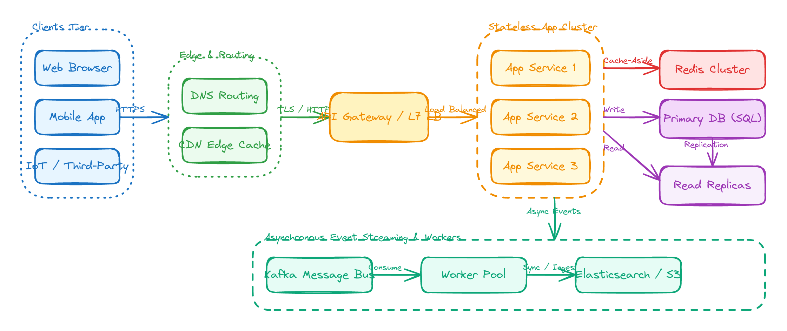
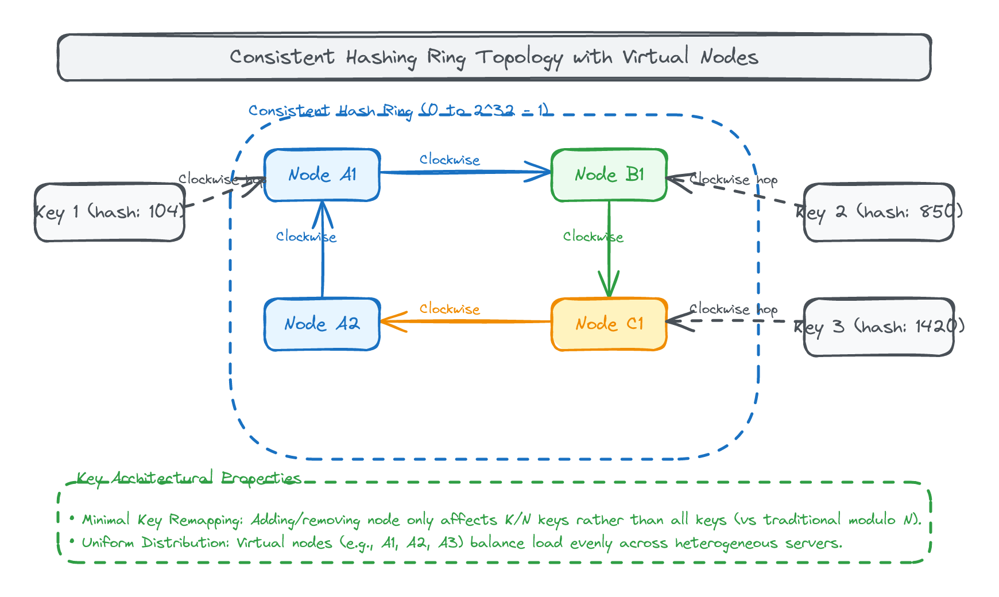

# System Design — From Basics to Expert

## The 5-Step System Design Framework

### Step 1: Requirements Clarification & Scope (3–5 mins)
- **Functional Requirements**: What core features are strictly in scope? What is explicitly out of scope?
  - Example (URL Shortener): Enter long URL → get short URL; enter short URL → redirect to original.
- **Non-Functional Requirements (NFRs)**:
  - **Availability vs Consistency**: Which side of CAP theorem does the business mandate? (e.g., 99.99% availability vs strict financial linearizability).
  - **Latency targets**: P95 / P99 read latency under 20ms; write latency under 100ms.
  - **Throughput & Scale**: Daily Active Users (DAU), read-to-write ratio, peak load multipliers.
  - **Durability & Security**: Data retention rules, GDPR/compliance, encryption in transit and at rest.

### Step 2: Back-of-the-Envelope Calculations (5 mins)
- **Traffic Estimates**:
  - $10\text{M DAU} \times 10\text{ writes/day} = 100\text{M writes/day}$.
  - Average Write QPS: $\frac{100{,}000{,}000}{86{,}400 \text{ sec}} \approx 1{,}160 \text{ writes/sec}$.
  - Peak Write QPS ($2\times \text{to } 3\times$): $\approx 2{,}500 - 3{,}500 \text{ QPS}$.
  - Read-heavy systems (e.g., 100:1 read-to-write ratio) $\to$ Peak Read QPS $\approx 350{,}000 \text{ QPS}$.
- **Storage Estimates**:
  - $100\text{M writes/day} \times 500\text{ bytes/record} = 50\text{ GB/day}$.
  - 5-year storage: $50\text{ GB} \times 365 \times 5 \approx 91.25\text{ TB}$.
- **Memory (Cache) Estimates**:
  - 80/20 Pareto Principle: 20% of content drives 80% of traffic.
  - Daily read cache: $20\% \times (10\text{B reads/day} \times 500\text{ bytes}) \approx 1\text{ TB RAM}$ across Redis cluster.

### Step 3: High-Level System Architecture (10–15 mins)
- **End-to-End Request Flow**:
  - Client $\to$ DNS (Geo-routing) $\to$ CDN (Static/Edge Cache) $\to$ Layer 7 Load Balancer / API Gateway $\to$ Stateless App Servers $\to$ Distributed Cache (Redis) $\to$ Database Cluster (Primary-Replica).
  - Asynchronous background paths: Event Broker (Kafka) $\to$ Consumer Workers $\to$ Search Index (Elasticsearch) / Analytics Lake (S3).

### Step 4: Deep Dive & Detailed Component Design (15–20 mins)
- Schema design & indexing strategies.
- API signatures (REST / gRPC).
- Algorithms, partitioning keys, and synchronization mechanisms.

### Step 5: Bottlenecks, Edge Cases & Resilience (5–10 mins)
- Single Points of Failure (SPOFs), database failovers, data replication lag.
- Hotspot keys ("Justin Bieber" problem) and cache stampedes.
- Network partitions, circuit breakers, and rate limiting.

---

## Core System Building Blocks

### Load Balancing & Traffic Routing
- **Layer 4 (Transport) vs Layer 7 (Application)**:
  - **L4 (HAProxy, AWS NLB)**: Routes at TCP/UDP level based on IP/Port. Ultra-high throughput, low CPU overhead, protocol agnostic.
  - **L7 (NGINX, Envoy, AWS ALB)**: Terminates HTTP/TLS; inspects headers, cookies, and URI paths for smart routing, gRPC multiplexing, and rate limiting.
- **Algorithms**: Round-Robin, Weighted Round-Robin, Least Connections, Consistent Hashing (session pinning).

### Caching Strategies & Eviction Policies
- **Caching Topologies**:
  - **Cache-Aside (Lazy Loading)**: App checks cache first; on miss, fetches from DB and populates cache. Resilient to cache failure, but initial cache misses incur higher latency.
  - **Read-Through**: App treats cache as the primary data store; cache transparently reads from DB on miss.
  - **Write-Through**: App writes to cache; cache writes synchronously to DB before returning success. Strong data consistency, higher write latency.
  - **Write-Behind (Write-Back)**: App writes to cache; cache asynchronously batches updates to DB. Ultra-low write latency; risk of data loss if cache crashes before sync.
- **Eviction Policies**:
  - **LRU (Least Recently Used)**: Evicts items untouched for the longest time (Doubly-linked list + Hash Map).
  - **LFU (Least Frequently Used)**: Tracks frequency counters; evicts items with the lowest access counts.
  - **FIFO**: Simple queue-based eviction.
- **Cache Anomalies**:
  - **Cache Stampede (Thundering Herd)**: Hot key expires $\to$ thousands of concurrent requests hammer DB. Fix: Mutex distributed locks or probabilistic early recomputation (XFetch).
  - **Cache Penetration**: Queries for non-existent keys bypass cache and directly hit DB. Fix: Bloom filters or caching `null` values with a short TTL.
  - **Cache Breakdown / Avalanche**: Multiple cache keys expire simultaneously $\to$ DB overload. Fix: Add random jitter to TTL values.

### Consistent Hashing
- Traditional modulo hashing ($H(k) \pmod N$) remaps almost all keys when a server node is added or removed ($N \to N \pm 1$).
- **Consistent Hash Ring ($0$ to $2^{32}-1$)**:
  - Both servers and keys are hashed onto a circular ring. A key is assigned to the first server encountered clockwise.
  - Adding/removing a server only impacts $K/N$ keys on average.
  - **Virtual Nodes (Vnodes)**: Maps each physical server to 100–200 positions on the ring to prevent hot spots and guarantee uniform data distribution.

### Database Sharding & Partitioning
- **Sharding Strategies**:
  - **Range-Based**: Shard by ID ranges ($1-1M$, $1M-2M$) or dates. Prone to hot spots for monotonically increasing keys.
  - **Hash-Based**: Hash shard key $\pmod{\text{number of shards}}$. Good distribution; range queries require querying all shards (scatter-gather).
  - **Directory-Based**: Lookup service maps keys to shard IDs. Flexible, but adds an extra hop and lookup table SPOF.
- **Sharding Complications**:
  - Cross-shard joins are slow or unsupported.
  - Transactions spanning multiple shards require expensive 2PC or Sagas.
  - Rebalancing shards during cluster growth requires complex data migrations.

---

## Architectural Case Studies

### 1. High-Performance URL Shortener (Bitly)
- **Scale**: 100M URLs created/month, 100:1 read ratio $\to$ 3,800 Read QPS.
- **Encoding Scheme**:
  - 6-character or 7-character Base62 string ($[0-9, a-z, A-Z]$).
  - $62^7 \approx 3.5 \text{ trillion}$ unique URLs.
  - Method: Auto-increment 64-bit ID generator (Twitter Snowflake or pre-allocated range counter) converted to Base62 (deterministic, zero collisions, $O(1)$).
- **Redirection**:
  - **301 Moved Permanently**: Browser caches redirect locally. Reduces server load, but prevents click analytics tracking.
  - **302 Found (Temporary)**: All requests hit the URL shortener first. Enables real-time click tracking, geolocation analytics, and abuse detection.

### 2. Scalable Ride-Sharing Dispatch (Uber / Lyft)
- **Challenge**: Millions of drivers sending GPS location every 3–4 seconds; riders requesting nearby drivers with sub-second matching.
- **Geospatial Indexing**:
  - Regular SQL queries with `ST_DWithin` degrade under high write throughput.
  - **Hierarchical Spatial Partitioning**:
    - **Uber H3**: Hexagonal hierarchical spatial index. Hexagons have equal distances to all 6 neighbors (unlike squares), simplifying radius searches.
    - **Google S2**: Quadtree projection mapping the earth onto a Hilbert space-filling curve with 64-bit integer cell IDs.
- **Architecture**:
  - Drivers stream coordinates via WebSockets/gRPC to Location Ingest Service $\to$ Ingest service batches and updates in-memory Redis Geospatial / Memory-mapped H3 index.
  - Match Engine queries candidate drivers within H3 ring cells and scores via ETA, rating, and route viability.

### 3. Real-Time Chat & Messaging (WhatsApp / Discord)
- **Challenge**: Low-latency bidirectional delivery, message delivery receipts, group chats, offline queuing.
- **Connection Layer**:
  - Persistent **WebSockets** or mutual TLS TCP connections maintained by stateless Gateway Connection Managers.
  - User session mapping stored in distributed Redis (`userId -> gatewayNodeId`).
- **Message Flow**:
  - Sender sends message $\to$ Gateway $\to$ Chat Service validates and saves to persistent store (Cassandra / ScyllaDB for append-heavy write throughput).
  - If recipient is online: Chat Service publishes to recipient's Gateway node via internal pub/sub $\to$ pushed over active WebSocket.
  - If recipient is offline: Message routed to Notification Service (APNs / FCM) for background push notification.

---

## Latency Numbers Every Systems Engineer Should Know
| Operation | Latency | Real-World Scale Comparison |
| :--- | :--- | :--- |
| **L1 cache reference** | $0.5\text{ ns}$ | 1 heartbeat |
| **Branch mispredict** | $5\text{ ns}$ | 10 heartbeats |
| **L2 cache reference** | $7\text{ ns}$ | 14 heartbeats |
| **Mutex lock / unlock** | $25\text{ ns}$ | 50 heartbeats |
| **Main memory (RAM) reference** | $100\text{ ns}$ | 3.3 minutes |
| **SSD random read** | $16\text{ µs}$ | 6.2 hours |
| **Read 1 MB sequentially from RAM** | $3\text{ µs}$ | 1.2 hours |
| **Read 1 MB sequentially from SSD** | $50\text{ µs}$ | 19.3 hours |
| **Round trip within same datacenter** | $500\text{ µs}$ | 6.8 days |
| **Read 1 MB sequentially from HDD** | $1\text{ ms}$ | 13.6 days |
| **Disk seek (mechanical HDD)** | $4\text{ ms}$ | 1.8 months |
| **Send packet CA $\to$ Netherlands $\to$ CA** | $150\text{ ms}$ | 5.7 years |
